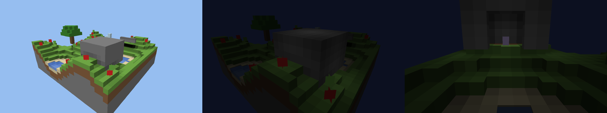

# TF2MC — Team Fortress 2 × Minecraft 26.3

A Source SDK 2013 (TF2) mod and a Minecraft 26.3 Fabric mod that run together as one game:

- **Minecraft runs headless** (dedicated server, `--nogui`) and stays authoritative for the world: terrain,
  block breaking/placing, mobs and AI, items, inventories, crafting, light, day/night, dimensions.
- **TF2 is the only window.** It mirrors the world, renders it, and uses it for collision, so the normal TF2
  player controller works on Minecraft terrain. That includes strafing, air control, rocket and sticky jumps
  and crouch-jumps, plus swimming and climbing ladders and vines.
- **Explore the whole world.** A floating origin re-centres Source's coordinate frame on the players as they
  travel, so there is no ±250-block limit. Portals take the whole party to the Nether and the End.
- **Play any TF2 class** with its normal weapons and mechanics:
  - Bullets, rockets, melee, flamethrowers and sentries all hurt Minecraft mobs.
  - Explosions carve craters in the terrain.
  - Mob attacks arrive as normal TF2 damage, so über, overheal, resistances and health packs apply.
- **Or play as a regular Minecraft player** (`mc_steve`, using the Civilian slot):
  - Movement: Minecraft walking speed and one-block jumps.
  - Digging, placing and fighting use real Minecraft rules: break times by tool, vanilla melee and armour.
  - Right-click mobs to trade, shear or milk them, and use bows and food.
  - Hotbar, hunger and XP HUD, and a full inventory screen. Chests, crafting tables, furnaces and villagers
    use their exact Minecraft layouts.

```
 ┌──────────────── Minecraft 26.3 dedicated server (headless) ───────────────┐
 │  tf2bridge (Fabric)                                                       │
 │   BridgeServer :25599 ─ WorldStreamer (block states + real shapes, light) │
 │                       ─ EntityStreamer (spawn/update/remove)              │
 │                       ─ BridgedPlayer × N (stand-in per TF2 player: loads │
 │                         chunks, mobs target it, digs/places/uses menus,   │
 │                         uses portals → party dimension travel)            │
 └────────────▲───────────────────────────────────────▲──────────────────────┘
   authority  │ players, actions, entities, world      │ observer: world, light, hotbar, menus
 ┌────────────┴──────────── server.dll ─┐   ┌─────────┴──────── client.dll (each player) ─┐
 │ mc_world: SOLID_CUSTOM → every trace  │   │ same voxel mirror → prediction, swimming,    │
 │   hits voxels (exact MC shapes)       │──▶│ climbing; chunk meshes with smooth sky light │
 │ VPhysics polysoups (pipes, stickies)  │net│ + torch-light pass, AO, day/night, water;    │
 │ floating origin + soft border         │   │ mob models, item sprites, health bars;       │
 │ mob proxies ↔ damage both ways        │   │ hotbar/hunger/XP HUD, inventory screen;      │
 │ sentries/flames/explosions vs MC      │   │ client physics (gibs, ragdolls)              │
 └───────────────────────────────────────┘   └──────────────────────────────────────────────┘
```

## What's in here

| Path | What |
|------|------|
| `source/src/game/shared/tf2mc/core/` | Engine-independent C++: protocol, threaded TCP client, voxel world with block states and light, multi-box swept-AABB collision, block picking, chunk mesher (culling, AO, smooth lighting, tints, liquids, waterlogging, plants, stairs/fences/doors), physics triangles |
| `source/src/game/shared/tf2mc/` | Code shared by both DLLs: `CMCBridge`; the `mc_world` collision entity; the `mc_mob` proxy (procedural mob models on the client); VPhysics mirror; swimming and climbing hooks |
| `source/src/game/server/tf2mc/` | Floating origin and border; player mirroring and party dimension travel; spawns; damage in both directions; Minecraft-mode input; sentries; explosions; chat; inventory commands |
| `source/src/game/client/tf2mc/` | Renderer (sky and block-light passes, origin translation), overlays, client physics, HUD, inventory screen, item icons |
| `source/patches/tf2mc.patch` | 18 small hooks in TF2 code plus VPC includes. `scripts/apply_tf2_hooks.py` inserts the same hooks if the SDK has moved on |
| `minecraft/` | Fabric mod `tf2bridge` for Minecraft 26.3 (Loom 1.17, Loader 0.19.5, Java 25, no Fabric API needed) |
| `game/mod_tf/` | Mod content: Minecraft-mode class file, materials, configs/binds, `maps/src/mc_world.vmf` |
| `tools/mc_assets.py` | Builds the block atlas, block definitions and item-icon atlas from **your own** Minecraft client jar |
| `tests/` | Core unit tests, a Java↔C++ end-to-end protocol test, software-rendered mesher previews |
| `docs/PROTOCOL.md` | Wire protocol v2 |

## Build

### 1. Minecraft side
Needs JDK 25.
```sh
cd minecraft
gradle wrapper --gradle-version 9.6.0     # once
./gradlew build                           # -> build/libs/tf2bridge-0.1.0.jar
```
1. Install a Fabric 26.3 server (Fabric installer → *Server*, Loader 0.19.5) in e.g. `~/mc-tf2`.
2. Put the jar in `mods/`, accept the EULA, and start the server once.
3. Settings are written to `config/tf2bridge.properties`: `port`, `bind-host`, `chunk-radius`,
   `entity-radius`, `mc-to-tf-damage`, `tf-explosions-break-blocks` and `secret`.

### 2. TF2 side
```sh
git clone https://github.com/ValveSoftware/source-sdk-2013
./scripts/install_into_sdk.sh ~/source-sdk-2013     # copies sources + content, applies the patch
cd ~/source-sdk-2013/src && ./buildallprojects        # Windows: createallprojects.bat, build everything.sln
```
Compile `game/mod_tf/maps/src/mc_world.vmf` once with the SDK map tools. It's an empty sealed sky box;
the world comes from Minecraft.

### 3. Textures and item icons (recommended)
```sh
pip install pillow
python3 tools/mc_assets.py ~/.minecraft/versions/26.3/26.3.jar ~/source-sdk-2013/game/mod_tf
```
Without this, blocks use flat per-block colours and items use coloured tiles. Mojang's assets are not
redistributed.

### GitHub Actions
`.github/workflows/build.yml` builds everything on push and PR, and on demand. To build against a
specific SDK commit, use *Run workflow* and set `sdk_ref`.

| Job | What it does |
|-----|--------------|
| `tests` | Core unit tests, the Java↔C++ end-to-end test, a strict C++14 check of the core with the SDK's banned-function macros, and mesher preview renders (artifact) |
| `minecraft` | `gradle build` of `tf2bridge` with JDK 25 → `minecraft-mod` artifact |
| `tf2-linux` | Clones `ValveSoftware/source-sdk-2013`, installs TF2MC (patch, or the hook script as fallback), then builds with VPC + ninja inside the Steam Runtime **sniper** SDK image. Uses `scripts/ci/build_sdk_linux.sh`, because the SDK's own `buildallprojects` needs an interactive podman session. ccache is cached between runs. Produces the `tf2-mod-linux` artifact |
| `tf2-windows` | Same install on `windows-2022`, `createallprojects.bat`, then MSBuild Release → `tf2-mod-windows` artifact |
| `package` | Merges both platforms' `mod_tf`, the Fabric jar, the tools and the launch scripts into `tf2mc-<ref>.zip`. Pushing a `v*` tag publishes it as a GitHub release |

You can run the Linux build locally the same way (Docker needed):
`scripts/ci/build_sdk_linux.sh ~/source-sdk-2013`.
Mojang assets are never built in CI. Each player runs `tools/mc_assets.py` on their own jar.

## Run
```sh
MC_DIR=~/mc-tf2 SDK_DIR=~/source-sdk-2013 ./scripts/run_all.sh
```

| | |
|---|---|
| Any TF2 class | Normal TF2 controls. `I` opens the Minecraft inventory (`mc_inventory`). Ladders: walk into them / jump. |
| `mc_steve` | Minecraft mode plus Minecraft binds:<br>• LMB hold: dig. LMB on a mob: vanilla melee.<br>• RMB: place or use (repeats while held; release fires bows). RMB on a mob: interact.<br>• `1`–`9` / mouse wheel: hotbar. `E`: inventory. `Q`: drop.<br>• `mc_tfbinds` restores the TF2 binds. |
| Inventory screen | • Click: pick up or place. Right-click: half or one.<br>• Shift-click: quick move. Double-click: collect.<br>• `1`–`9` over a slot: swap with that hotbar slot. `F`: offhand. `Q`: throw.<br>• Click outside the window: drop. `E` / `Esc`: close. |
| Server | `mc_connect [host] [port]`, `mc_disconnect`, `mc_status`, `mc_rebase <x> <z>`, `mc_rebase_distance`, `mc_border_units`, `mc_respawn_near_team`, `mc_tf_explosions`, `mc_sentries_target_mobs`, `mc_food_heal`, `mc_chat_bridge`, `mc_scale`, `mc_damage_to_mc`, `mc_reach`, `mc_max_mobs`, `mc_public_host` |
| Client | `cl_mc_status`, `mc_draw`, `mc_ao`, `mc_glow`, `mc_daynight`, `mc_mesh_budget`, `mc_highlight`, `mc_mob_boxes`, `mc_mob_healthbars`, `mc_flip_winding` |

**Exploring.** When any player gets `mc_rebase_distance` (96) blocks from the current origin, the server
re-centres the origin on the group. Every entity, projectile, building and physics object shifts with it.
Chunk meshes aren't rebuilt; they're translated when drawn. You'll only meet a soft border if players
spread out more than about 480 blocks: Source can't hold them all in one map, so the edge tells you to
regroup. Dead players respawn next to a living teammate (`mc_respawn_near_team`).

**Dimensions.** When anyone goes through a portal, the whole party follows. Everyone respawns at the
arrival point, and buildings are cleared.

**Remote players.** Each client connects to the bridge itself (for rendering and prediction). The bridge
port must be reachable from players: set `mc_public_host`, plus `bind-host=0.0.0.0` and a `secret` in
`tf2bridge.properties`.

## Tests
```sh
tests/run_tests.sh   # 196 core unit checks: protocol, coords + origin shifts, states/shapes, light,
                     # multi-box collision (fences, stairs), picking, water/climbing, mesher, lighting
tests/run_e2e.sh     # real Java BridgeServer + fake world <-> C++ client: states, light, streaming,
                     # collision, dig, place, explosion crater, inventory view, killing a mob
tests/run_preview.sh # meshes a scene with the real mesher and software-renders it
```
`FakeWorldServer` (`./gradlew fakeWorld`) also stands in for Minecraft while you work on the TF2 side.



## Status — what has and hasn't been verified
- **Verified here:**
  - The engine-independent C++ core (unit tests).
  - The Java networking/protocol layer, talking end to end with the C++ client (`run_e2e.sh`).
  - The asset tool (block atlas, item atlas, isometric icons) on a synthetic jar.
  - The mesher's output, by software rendering (images above).
  - The TF2 patch applies cleanly to the current `source-sdk-2013`, and the hook script is idempotent.
- **Compiled:**
  - **TF2 mod (Linux):** compiles and links against the current `source-sdk-2013` with the SDK's own
    VPC/ninja build. All TF2MC sources and the patched TF2 files build for both DLLs, with no warnings
    in TF2MC code and no unresolved TF2MC symbols.
  - **Minecraft mod:** compiles against Minecraft 26.3 with Fabric Loom in GitHub Actions.
- **Not yet verified:**
  - In-game behaviour: running TF2 and Minecraft together.
  - Mixin targets, which are only checked when the mod loads.
  - The Windows build.
- If the world looks inside-out, toggle `mc_flip_winding 1`.

## Known limitations
- **Shapes:** block shapes use the real Minecraft collision and outline shapes, but textures are per block
  rather than per model element. Stairs, for example, show their side texture on every box.
- **Lighting:**
  - Light is Minecraft's sky and block light with smooth lighting and AO.
  - TF2 player models are still lit by the map's fixed light environment, not by Minecraft light.
  - Torch light is white-warm, with no coloured light.
- **Mobs:**
  - They are procedural low-poly models for about 25 common types; others are fitted boxes.
  - Any mob can be mapped to a real model in `scripts/mc_entity_models.txt`.
  - Only sentries and flamethrowers have been taught about mobs; other TF2 bots don't target them.
- **Origin shifts:** ragdolls on screen during an origin shift are hidden rather than moved.
- **Party travel:** players must stay within about 480 blocks of each other, and the party is in one
  dimension at a time (by design, since TF2 has one map).
